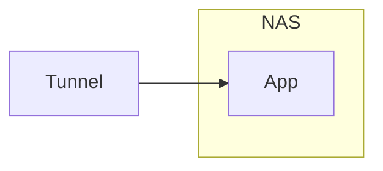
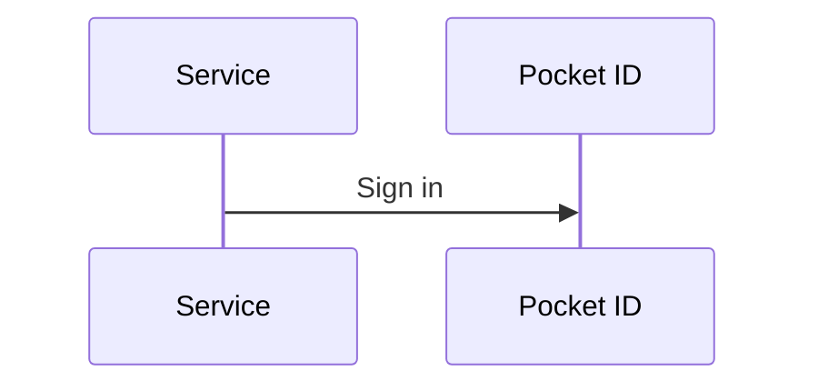

# Minimal Catppuccin

Updates [Minimal Theme](https://github.com/kepano/obsidian-minimal)'s built-in **Catppuccin** color scheme to the official [Catppuccin](https://github.com/catppuccin/catppuccin) Latte and Mocha colors, with Lavender accents.

Also colors [Mermaid](https://mermaid.js.org/) diagrams. No settings, commands, or network access.

## Requirements

- [Minimal Theme](https://github.com/kepano/obsidian-minimal)
- [Minimal Theme Settings](https://github.com/kepano/obsidian-minimal-settings), with **Catppuccin** selected as the light or dark color scheme

## Install

### With BRAT

1. Install the [BRAT](https://github.com/TfTHacker/obsidian42-brat) community plugin.
2. In **Settings → BRAT**, select **Add beta plugin** and enter this repository's URL.
3. Enable **Minimal Catppuccin** in **Settings → Community plugins**.

### Manually

Copy `main.js`, `manifest.json`, and `styles.css` from the latest release to `<Vault>/.obsidian/plugins/minimal-catppuccin/`, then enable **Minimal Catppuccin** in **Settings → Community plugins**.

## Colors

Code follows [Catppuccin Neovim's default mappings](https://github.com/catppuccin/nvim/blob/edefef779ab08ce1a4a404713e3012b0d202bd35/lua/catppuccin/groups/treesitter.lua). Everything else follows the [Catppuccin style guide](https://github.com/catppuccin/catppuccin/blob/d09787dd98ca6fba08af5ef2ae94a7e09f17daca/docs/style-guide.md).

## Mermaid

When Catppuccin is the active color scheme, diagrams use Mermaid's `base` theme with the current flavor's colors and redraw when you switch between light and dark. Obsidian's dark-mode color inversion is turned off, and wide diagrams shrink to fit the note. With any other color scheme, diagrams look as they do without this plugin.

Color flowchart nodes, subgraphs, and sequence participants with these classes:

| Class | Effect |
| --- | --- |
| `ctp-red`, `ctp-orange`, `ctp-yellow`, `ctp-green`, `ctp-cyan`, `ctp-blue`, `ctp-purple`, `ctp-pink` | Tinted fill and accent border. Subgraphs get a lighter tint. |
| `ctp-dashed` | Dashed border, faded. For planned or optional parts. |

In sequence diagrams, set the class with `properties`. Keep `actor` in the value; Mermaid replaces its own class with it. Stick-figure actors (`actor` instead of `participant`) ignore classes.

A box with the `internal-link` class opens the note with the same name as its label. The label keeps the box text color.

Mindmap branches follow the [official Catppuccin theme](https://github.com/catppuccin/obsidian): orange, yellow, green, red, blue, purple, pink, cyan, then orange, yellow, green again. Mermaid has 11 branch colors, so the 12th branch starts over at orange. The root is lavender.

Do not use `classDef` or `%%{init}%%` colors with this plugin: they are fixed hex values that do not change with the flavor.

## Troubleshooting

If colors do not match, reset color overrides in Style Settings or turn off other color snippets.

## Known limits

- Official Latte blue links, code colors, callout titles, and **Colorful headings** are hard to read on the light background.
- **Colorful frame** shows no color in Latte. In Mocha it is a bright blue that is not a Catppuccin color.
- With Latte **High contrast**, Mermaid diagrams in the dark sidebars use Latte colors.

## Release

1. Update `version` in `manifest.json` and add it to `versions.json`.
2. Commit, then push a tag that exactly matches the version, without a leading `v` (for example `1.0.1`). The release workflow attaches `main.js`, `manifest.json`, and `styles.css` to the GitHub release.
